# Mô tả chi tiết hệ thống đấu giá biển số

Tài liệu này mô tả cách các thành phần trong dự án liên kết với nhau: JavaFX client, server, database, WebSocket, cloud Railway, quy trình vẽ đồ thị giá, diễn biến phiên đấu giá và quá trình kết thúc phiên.

## 1. Tổng quan kiến trúc

Ứng dụng là hệ thống đấu giá biển số xe bằng JavaFX. Client chạy giao diện người dùng/admin, kết nối trực tiếp tới MySQL trên Railway thông qua các lớp DAO, đồng thời kết nối WebSocket tới server realtime trên Railway để nhận cập nhật giá, thời gian và kết quả phiên đấu giá.

Trong code hiện tại có 2 hướng giao tiếp:

- Luồng chính của UI JavaFX: controller gọi service/DAO để đọc ghi database.
- Luồng realtime: `AuctionWebSocketClient` kết nối tới `AuctionWebSocketServer`, subscribe theo `itemId`, gửi/nhận JSON message để đồng bộ giá và sự kiện phiên.

Ngoài ra còn có `ClientHandler` xử lý command JSON qua TCP socket theo kiểu request/response, nhưng luồng JavaFX hiện tại đang dùng DAO trực tiếp và WebSocket nhiều hơn.

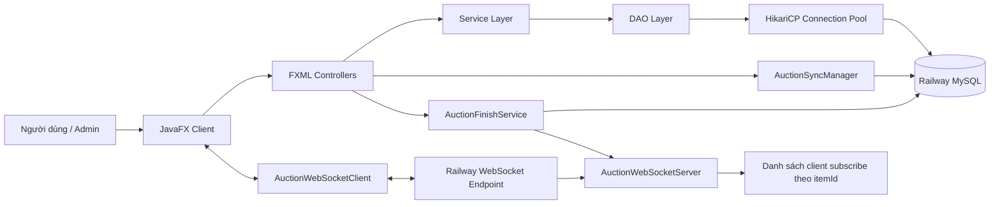

## 2. Client hoạt động như thế nào

Client là ứng dụng JavaFX, khởi động từ `com.auction.main.App`.

Khi mở app:

1. `App.start()` gọi `DatabaseHealthCheck.isDatabaseAlive()` để kiểm tra database.
2. Nếu database sống, app gọi `DatabaseInitializer.initDatabase()` để tạo bảng nếu chưa có.
3. JavaFX load `Login.fxml`.
4. Sau khi đăng nhập, người dùng đi tới dashboard, phòng đấu giá, lịch sử, kết quả; admin đi tới màn hình duyệt biển, giám sát phiên, quản lý user.

Controller quan trọng:

- `DashboardController`: hiển thị danh sách biển số đã duyệt, trạng thái đăng ký/đấu giá/kết thúc, nút vào phòng đấu giá.
- `AuctionRoomController`: màn hình đấu giá thực tế, hiện giá hiện tại, đồng hồ, lịch sử đặt giá, đồ thị giá, nút đặt giá.
- `AdminController`: duyệt biển số, cấu hình thời gian đăng ký và đấu giá, giám sát realtime các phiên.
- `AuctionHistoryController` và `AuctionResultController`: xem lịch sử đặt giá và kết quả.

Dashboard không tự đếm giờ độc lập. Mỗi card trên dashboard đăng ký listener vào `AuctionSyncManager`. Manager này cứ 1 giây đọc snapshot từ DB và đẩy lại cho UI, nhờ vậy dashboard và phòng đấu giá có cùng nguồn thời gian.

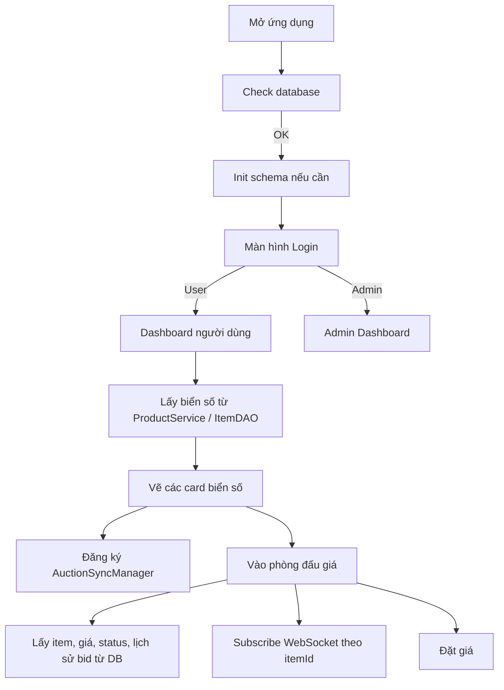

## 3. Server và WebSocket hoạt động như thế nào

### 3.1 AuctionServer

`AuctionServer.main()` khởi động `AuctionWebSocketServer`. Khi JVM tắt, shutdown hook sẽ dừng WebSocket server an toàn.

Server bind vào địa chỉ `0.0.0.0` và lấy port theo biến môi trường `PORT`. Nếu không có `PORT`, server dùng port mặc định `8081`. Cách này phù hợp Railway vì Railway cấp port động qua biến môi trường.

### 3.2 AuctionWebSocketServer

`AuctionWebSocketServer` là singleton, kế thừa `org.java_websocket.server.WebSocketServer`.

Server quản lý subscriber theo 2 chiều:

- `itemSubscribers`: `itemId -> Set<WebSocket>`, để biết item nào đang có những client nào theo dõi.
- `clientSubscriptions`: `WebSocket -> Set<itemId>`, để khi client mất kết nối có thể xóa nhanh khỏi tất cả phòng đã subscribe.

Server nhận các message JSON chính:

| Message từ client | Ý nghĩa | Xử lý |
|---|---|---|
| `SUBSCRIBE` | Client vào phòng đấu giá của 1 item | Thêm socket vào danh sách theo `itemId`, gửi lại `SUBSCRIBED` |
| `UNSUBSCRIBE` | Client rời phòng | Xóa socket khỏi phòng đó |
| `NEW_BID` | Có bid mới | Broadcast `PRICE_UPDATE` cho tất cả client đang subscribe cùng `itemId` |

Server gửi các message realtime:

| Message từ server | Nội dung |
|---|---|
| `PRICE_UPDATE` | Giá mới, bidder, thời điểm đặt giá |
| `PARTICIPANT_UPDATE` | Số người tham gia |
| `AUCTION_FINISHED` | Phiên kết thúc, giá cuối, người thắng |
| `TIMER_EXTENDED` | Thời gian được gia hạn |
| `SUBSCRIBED` | Xác nhận client đã subscribe |

Server có cleanup định kỳ mỗi 30 giây để xóa connection chết, tránh rò rỉ bộ nhớ trên cloud.

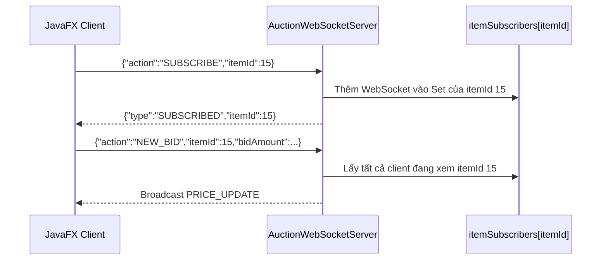

## 4. Database hoạt động như thế nào

Database là MySQL trên Railway. File cấu hình `database.properties` chứa JDBC URL, username và password. Tài liệu này không ghi lại password vì đó là thông tin nhạy cảm.

`DatabaseConnection` tạo HikariCP connection pool:

- Tối đa 5 connection để tránh quá tải DB cloud.
- Tối thiểu 1 idle connection.
- Timeout 10 giây để app không treo quá lâu khi hết connection.
- Max lifetime 5 phút, keepalive 60 giây để phù hợp môi trường Railway.
- `SET time_zone = '+07:00'` để đồng bộ thời gian Việt Nam cho các mốc đấu giá.

Bảng chính:

| Bảng | Vai trò |
|---|---|
| `users` | Lưu tài khoản user/admin/seller, mật khẩu hash, thông tin liên hệ |
| `items` | Lưu biển số, giá khởi điểm, giá hiện tại, người bán, trạng thái duyệt, trạng thái đấu giá, thời gian đăng ký/đấu giá |
| `auctions` | Bảng phiên đấu giá theo schema cũ/bổ sung |
| `bids` | Lưu lịch sử đặt giá: item, user, số tiền, thời điểm |
| `auction_results` | Được `AuctionFinishService` ghi nếu bảng tồn tại |

Quan hệ dữ liệu có thể hiểu như sau:

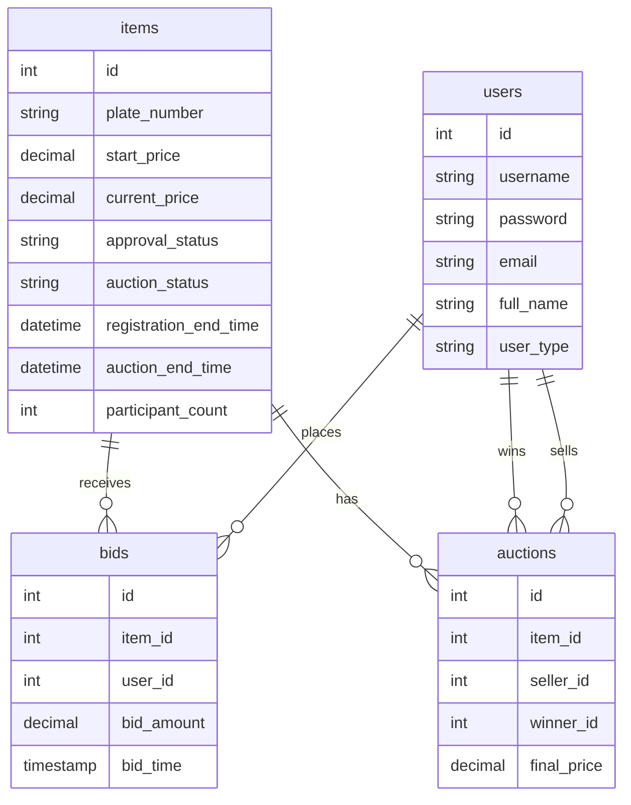

## 5. Cloud Railway liên kết vào hệ thống

Railway đang được dùng cho 2 phần:

1. MySQL cloud: JavaFX client và service/DAO kết nối qua JDBC.
2. WebSocket server: client kết nối tới endpoint `wss://plateauction-production.up.railway.app`.

Trên Railway, WebSocket server không nên hard-code port. `AuctionWebSocketServer.getDynamicPort()` đọc biến `PORT`, nếu không có thì dùng `8081` khi chạy local.

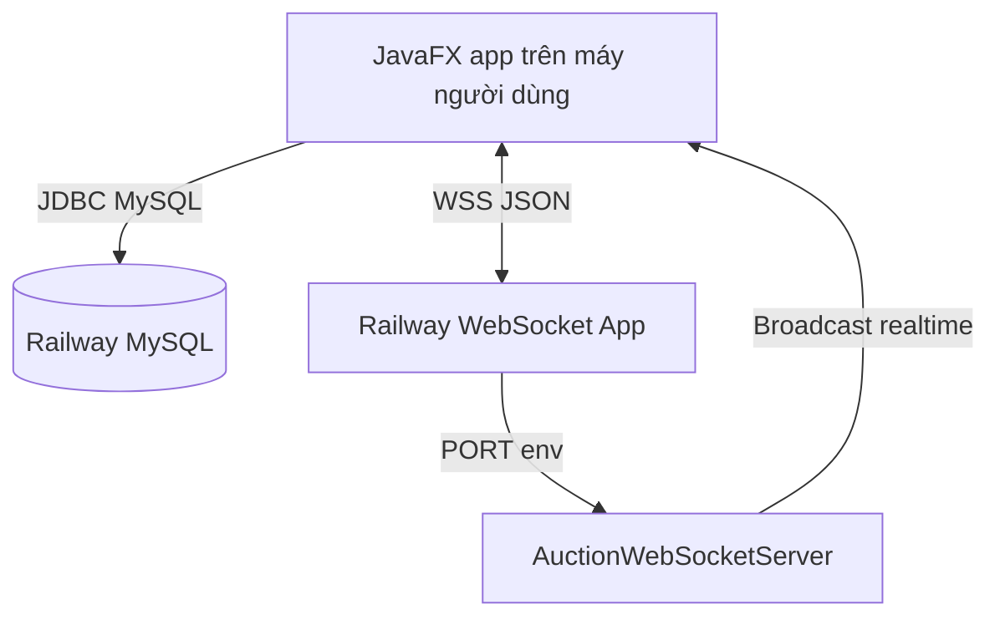

## 6. Quy trình người bán đăng ký biển số và admin duyệt

Người bán nhập biển số, loại xe, giá khởi điểm, thông tin liên hệ. `ProductService.addNewProduct()` kiểm tra biển số đã tồn tại bằng `ItemDAO.plateExists()`. Nếu chưa tồn tại, `ItemDAO.addItemFromSeller()` thêm vào bảng `items` với:

- `status = ACTIVE`
- `approval_status = PENDING`
- `current_price = start_price`
- thông tin người bán

Admin vào màn hình chờ duyệt. `AdminController.loadPendingView()` lấy danh sách từ `ProductService.getPendingProducts()` và `ItemDAO.getPendingItems()`.

Khi admin bấm duyệt:

1. `ProductService.approveProduct()` gọi `ItemDAO.approveItem()`, đổi `approval_status` thành `APPROVED`.
2. Admin nhập thời gian chờ đăng ký và thời lượng đấu giá.
3. `ItemDAO.startRegistrationPhase()` cập nhật:
   - `registration_start_time = NOW()`
   - `registration_end_time = NOW() + regMinutes`
   - `auction_start_time = NOW() + regMinutes`
   - `auction_end_time = auction_start_time + aucMinutes`
   - `auction_status = REGISTRATION`

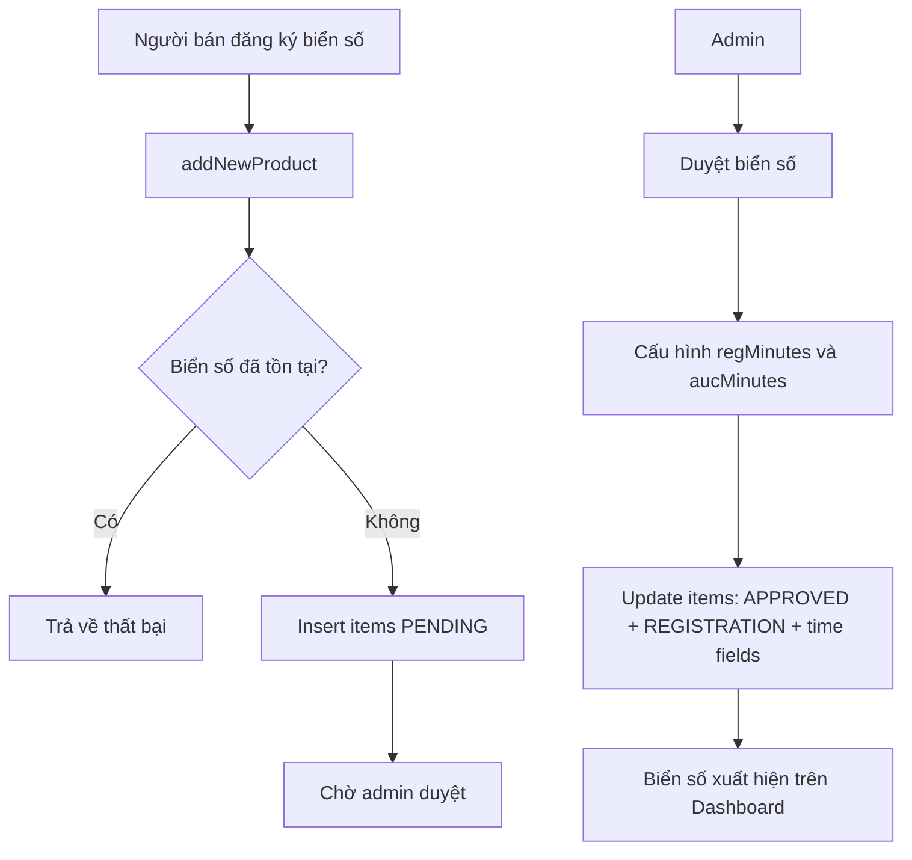

## 7. Vòng đời một phiên đấu giá

Mỗi item có `auction_status`:

- `WAITING`: chưa setup hoặc chưa vào giai đoạn đăng ký.
- `REGISTRATION`: đã duyệt, đang trong thời gian chờ/đăng ký.
- `AUCTION`: đang mở đấu giá.
- `FINISHED`: đã hết giờ, có kết quả.

`AuctionSyncManager` là bộ đồng bộ thời gian:

1. Controller đăng ký listener theo `itemId`.
2. Manager bật scheduler nền, mỗi 1 giây query `items`.
3. Nếu status là `REGISTRATION`, tính thời gian còn lại theo `registration_end_time`.
4. Nếu status là `AUCTION`, tính thời gian còn lại theo `auction_end_time`.
5. Nếu hết giờ đăng ký, chuyển `REGISTRATION -> AUCTION`.
6. Nếu hết giờ đấu giá, chuyển `AUCTION -> FINISHED`.
7. Gọi callback trên JavaFX Application Thread để UI cập nhật an toàn.

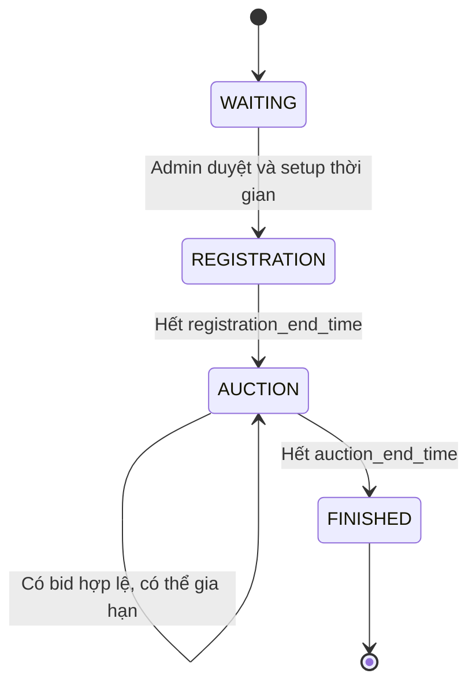

## 8. Quá trình vào phòng đấu giá

Khi người dùng bấm vào đấu giá:

1. `DashboardController` kiểm tra lại status thực tế bằng `ItemDAO.getAuctionStatus(plate)`.
2. Nếu `WAITING` hoặc `REGISTRATION`, UI thông báo chưa mở.
3. Nếu `FINISHED`, UI thông báo phiên đã kết thúc.
4. Nếu `AUCTION`, controller load `AuctionRoom.fxml`.
5. `AuctionRoomController.setAuctionRoomData()` đọc thông tin đầy đủ bằng `ItemDAO.getItemFullData(plate)`.
6. Lấy `current_price`, `itemId`, `auction_end_time`.
7. Khởi tạo đồ thị bằng `initChartSeries()`.
8. Khôi phục lịch sử bid từ DB bằng `BidDAO.getBidHistoryForChart(itemId)`.
9. Đăng ký `AuctionSyncManager` để cập nhật đồng hồ mỗi giây.
10. Tạo/lay `AuctionWebSocketClient`, add listener và subscribe `itemId`.

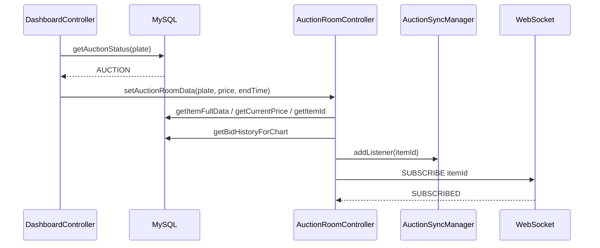

## 9. Quy trình đặt giá chi tiết

Người dùng trong `AuctionRoomController` bấm nút đặt giá.

Giá mới được tính:

```text
newBid = latestPrice + (5,000,000 * stepMultiplier)
```

Trong đó:

- `latestPrice` lấy lại từ DB bằng `ItemDAO.getCurrentPrice(currentPlateNumber)`.
- `stepValue = 5,000,000`.
- `stepMultiplier` tăng/giảm bằng nút trên UI.

Sau đó `BidDAO.saveBid()` xử lý transaction:

1. Mở connection và `setAutoCommit(false)`.
2. Lock row item bằng `SELECT ... FOR UPDATE`.
3. Kiểm tra item tồn tại.
4. Kiểm tra `auction_end_time` chưa qua.
5. Kiểm tra `auction_status = AUCTION`.
6. Kiểm tra cooldown của user, hiện tại là 10 giây theo `BID_COOLDOWN_SECONDS`.
7. Kiểm tra `bidAmount > currentPrice`.
8. Insert vào `bids`.
9. Update `items.current_price`.
10. Commit.

Nếu bất kỳ bước nào lỗi, transaction rollback và UI hiện thông báo thất bại.

Sau khi DB lưu thành công:

1. Controller đọc lại `currentPrice`.
2. Reset `stepMultiplier = 1`.
3. Nếu còn 30 giây cuối, gọi `ItemDAO.extendAuctionTime(plate, 60)` để gia hạn 60 giây.
4. Gửi WebSocket message `NEW_BID` gồm `itemId`, `bidAmount`, `bidderId`, `bidderName`, `bidTime`.
5. WebSocket server broadcast `PRICE_UPDATE` tới mọi client đang subscribe item đó.

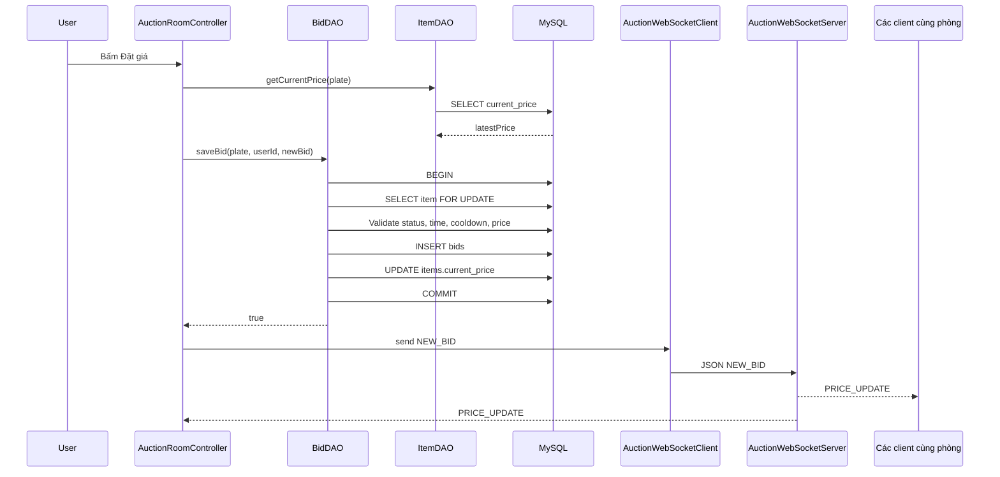

## 10. WebSocket cập nhật UI realtime như thế nào

`AuctionWebSocketClient` là singleton của client. Khi tạo lần đầu, nó kết nối tới `wss://plateauction-production.up.railway.app`.

Client có cơ chế reconnect:

- Nếu mất kết nối không chủ ý, `triggerAutoReconnect()` dùng exponential backoff có jitter.
- Nếu thư viện WebSocket rơi vào trạng thái khó khôi phục, `triggerHardReconnect()` tạo client mới và chuyển listener sang instance mới.

`AuctionRoomController` implement `AuctionWebSocketClient.AuctionWebSocketListener`. Khi nhận `PRICE_UPDATE`:

1. Kiểm tra `itemId` có đúng phòng hiện tại không.
2. Cập nhật giá hiển thị bằng `UiThrottle` để tránh UI bị giật khi nhận quá nhiều sự kiện.
3. Gọi `Platform.runLater()` để cập nhật JavaFX UI an toàn.
4. Thêm dòng lịch sử mới vào `liveHistoryContainer`.
5. Thêm điểm mới vào `LineChart`.
6. Tăng số lần đặt giá.

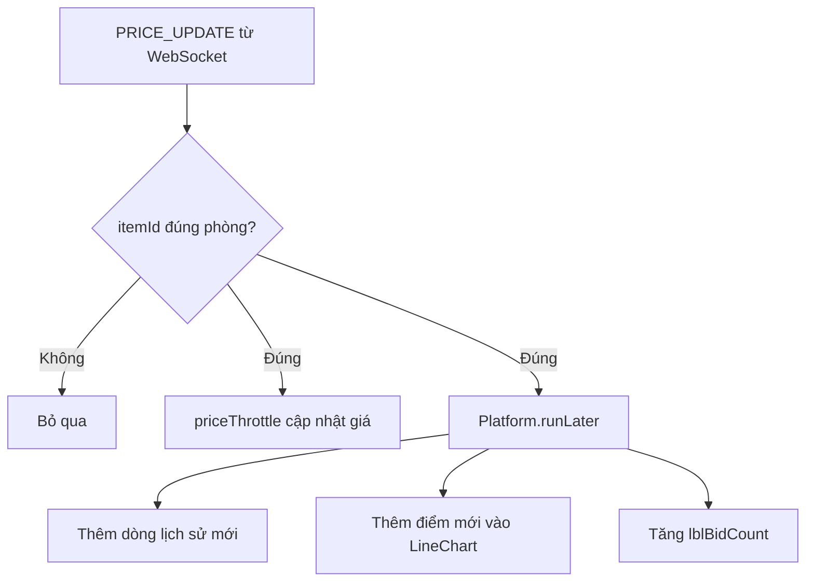

## 11. Quy trình vẽ đồ thị giá

Đồ thị giá nằm trong `AuctionRoomController`, dùng `LineChart<Number, Number>` của JavaFX.

### 11.1 Khi mới vào phòng

1. `initChartSeries()` tạo `XYChart.Series`.
2. Đặt tên series là `Giá đặt`.
3. Tắt animation để đồ thị cập nhật nhanh hơn.
4. Xóa data cũ và add series mới vào `priceHistoryChart`.
5. `restoreBidHistoryAsync()` chạy thread nền để đọc lịch sử bid từ DB.
6. `BidDAO.getBidHistoryForChart(itemId)` query:
   - `bids.id`
   - `bids.bid_amount`
   - `bids.bid_time`
   - `users.full_name`
   - sắp xếp `ORDER BY b.bid_time ASC`
7. UI thread vẽ lại từng điểm từ cũ tới mới.
8. Mỗi điểm có tooltip hiện giá.
9. Lịch sử text bên cạnh đồ thị được đổ từ mới tới cũ.

### 11.2 Khi có bid mới realtime

Khi nhận `PRICE_UPDATE`, controller không load lại toàn bộ chart. Thay vào đó:

1. Tăng `chartPointCount`.
2. Tạo `XYChart.Data<>(chartPointCount, newPrice)`.
3. Tạo node hình tròn nhỏ làm điểm.
4. Gắn tooltip: tên người đặt + số tiền.
5. Add data point vào series hiện tại.

Đây là cập nhật incremental, giúp chart không bị nhảy, không query DB lại mỗi lần có bid.

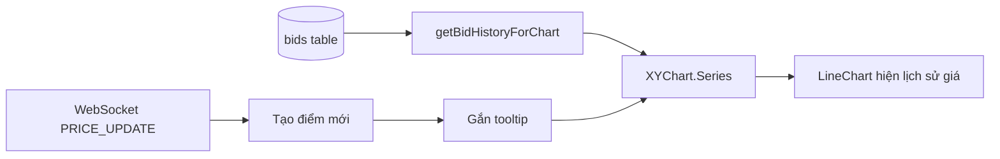

## 12. Gia hạn thời gian và chống đặt giá phút chót

Hệ thống có logic anti-sniping:

- Trong `AuctionRoomController.handlePlaceBid()`: nếu thời gian còn lại `> 0` và `<= 30` giây, app gia hạn `auction_end_time` thêm 60 giây bằng `ItemDAO.extendAuctionTime(plate, 60)`.
- Controller gửi message `EXTEND_TIME` qua WebSocket, tuy nhiên server hiện tại chưa có nhánh xử lý `EXTEND_TIME` trong `AuctionWebSocketServer.onMessage()`.
- Trong `ClientHandler.handlePlaceBid()` có logic khác: nếu `BidDAO.shouldExtendAuction(itemId)` thì `ItemDAO.extendAuctionTime(itemId, 2)` theo phút và broadcast `TIMER_EXTENDED`.

Điều cần lưu ý: code hiện tại tồn tại 2 cách gia hạn:

- Gia hạn 60 giây theo biển số trong `AuctionRoomController`.
- Gia hạn 2 phút theo itemId trong `ClientHandler`.

Nếu hệ thống chạy thuần theo JavaFX + WebSocket, cần đảm bảo server WebSocket có xử lý `EXTEND_TIME` hoặc controller chủ động broadcast `TIMER_EXTENDED` sau khi update DB. Hiện tại UI vẫn lấy thời gian từ DB qua `AuctionSyncManager`, nên đồng hồ sẽ đúng theo DB, nhưng popup `TIMER_EXTENDED` có thể không tới các client nếu server không broadcast.

## 13. Kết thúc phiên đấu giá

Có 2 cơ chế kết thúc:

### 13.1 AuctionSyncManager

Khi UI đang có listener, `AuctionSyncManager` mỗi giây đọc DB. Nếu `auction_status = AUCTION` và thời gian còn lại về 0, manager update DB thành `FINISHED` và gọi `onAuctionEnded(itemId, finalPrice)` cho controller.

Phòng đấu giá nhận event này sẽ:

1. Set `auctionEnded = true`.
2. Gọi `determineResultAndShowDialog(finalPrice)`.
3. Lấy winner bằng `ItemDAO.getWinnerByPlate(currentPlateNumber)`.
4. So sánh winner với user hiện tại.
5. Hiện popup kết quả.
6. Disable nút đặt giá.
7. Gọi `teardown()` để gỡ listener, unsubscribe WebSocket, tắt throttle.

### 13.2 AuctionFinishService

`AuctionFinishService` là singleton poll mỗi 5 giây. Nó query các item:

```sql
WHERE auction_status = 'AUCTION'
AND auction_end_time IS NOT NULL
AND auction_end_time <= NOW()
```

Với mỗi phiên hết hạn:

1. `markAsFinished()` update atomic: chỉ update nếu status còn là `AUCTION`.
2. Tìm winner bằng bid cao nhất.
3. Lưu kết quả vào `auction_results` nếu bảng tồn tại.
4. Broadcast `AUCTION_FINISHED` qua WebSocket.
5. Notify listener trên JavaFX thread, ví dụ dashboard cập nhật card thành đã kết thúc.

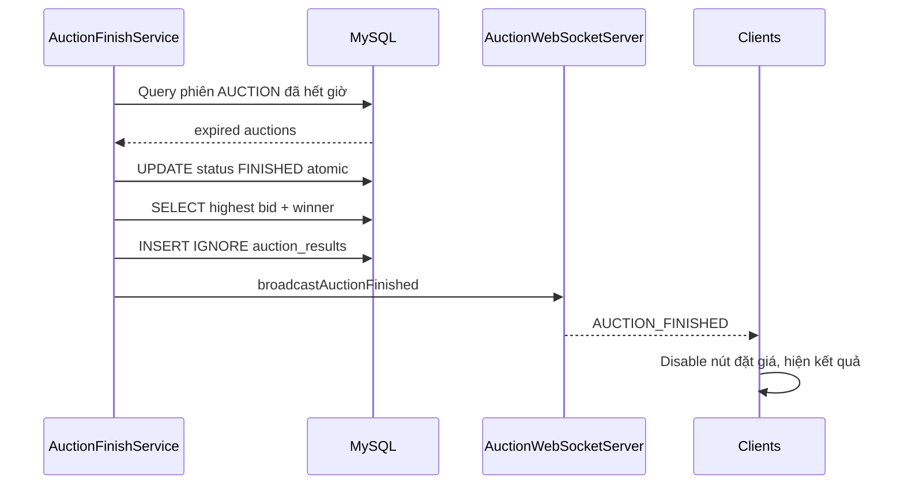

## 14. Luồng admin giám sát realtime

Admin vào tab giám sát, `AdminController.loadMonitoringView()` gọi `ItemDAO.getFullMonitoringData()`.

Dữ liệu gồm:

- biển số
- loại xe
- `auction_status`
- `current_price`
- `auction_end_time`
- `registration_end_time`
- `participant_count`
- `highest_bidder`
- `highest_bid`

Với mỗi dòng, admin controller tạo listener vào `AuctionSyncManager`. Mỗi tick:

1. Cập nhật đếm ngược.
2. Cập nhật style trạng thái: chuẩn bị, đang đấu, kết thúc.
3. Nếu giá thay đổi, update label giá.
4. Chạy thread nền để lấy winner/top bidder mới bằng `ItemDAO.getWinnerByPlate(plate)`.

Như vậy admin không cần vào từng phòng vẫn thấy diễn biến chính của các phiên.

## 15. Tóm tắt luồng đấu giá từ đầu đến cuối

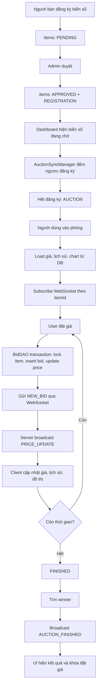

## 16. Điểm cần chú ý trong code hiện tại

1. `ClientHandler` có logic `PLACE_BID` riêng với cooldown 60 giây, trong khi `BidDAO.saveBid()` đang dùng cooldown 10 giây. Nếu dùng song song TCP và JavaFX trực tiếp, cần thống nhất rule.
2. `AuctionRoomController` gửi `EXTEND_TIME`, nhưng `AuctionWebSocketServer` hiện chỉ xử lý `SUBSCRIBE`, `UNSUBSCRIBE`, `NEW_BID`. Nếu muốn popup gia hạn realtime, server cần bổ sung xử lý `EXTEND_TIME` và broadcast `TIMER_EXTENDED`.
3. `AuctionFinishService.start()` được comment là nên gọi trong `App.java`, nhưng `App.start()` hiện tại chưa thấy gọi. Dashboard có add listener vào service, nhưng nếu service không start thì cơ chế poll 5 giây không chạy. `AuctionSyncManager` vẫn có thể chuyển status khi có UI listener.
4. File `database.properties` đang chứa thông tin kết nối thật. Nên đưa file này ra khỏi Git và chỉ commit `database.properties.example`, dùng biến môi trường hoặc secret manager khi deploy.

## 17. Kết luận

Hệ thống hoạt động theo mô hình database làm nguồn dữ liệu chuẩn, WebSocket làm kênh realtime, JavaFX controller làm nơi điều phối UI. Mỗi lần đặt giá hợp lệ đều được ghi vào DB trước, sau đó mới broadcast realtime. Đồ thị giá không tự tính riêng mà được vẽ từ lịch sử `bids` khi vào phòng và cập nhật thêm điểm mới mỗi khi có `PRICE_UPDATE`. Vòng đời phiên được điều khiển bởi các mốc thời gian trong bảng `items`, được `AuctionSyncManager` và `AuctionFinishService` theo dõi để chuyển trạng thái và thông báo kết quả.
